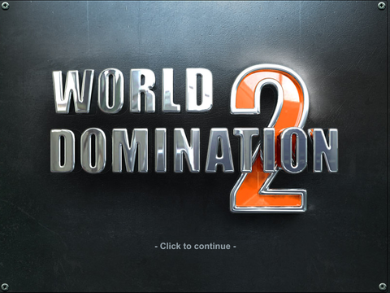
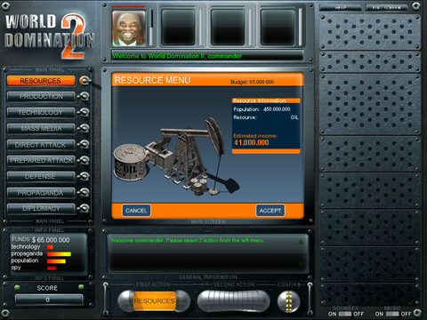

# World Domination 2 (WorldDomination2) — Python game

An unofficial Python reconstruction of **World Domination II**, also known as
**World Domination 2**, the turn-based Flash strategy game by YoudaGames.
Play locally on Windows or Linux against one to four computer opponents using
resources, technology, diplomacy, propaganda and military attacks.

This WorldDomination2 GitHub repository includes the Python game, runtime assets
and tests. The original splash screen, setup menu, map, city artwork and gameplay
interface run without Flash, a browser or the original SWF.

The original gameplay rules and AI run through translated Python classes, with
the original setup, action controls and presentation. Rendering and timing still
have fidelity differences; pixel-perfect equivalence is not claimed.

<p>
  
  
</p>

## Download and play World Domination 2

Use Python 3.12 or newer on Windows or Linux. Download and extract the
[latest source ZIP](https://github.com/Rifat-Rashid/WorldDomination2/archive/refs/heads/main.zip),
then open a terminal in the extracted folder and run:

```sh
python -m pip install -r requirements.txt
python run_game.py
```

Or clone the repository with Git:

```sh
git clone https://github.com/Rifat-Rashid/WorldDomination2.git
cd WorldDomination2
python -m pip install -r requirements.txt
python run_game.py
```

The original logo and intro video play first; click the video to skip it, or use
`python run_game.py --skip-intro` to open directly on the title. Then click the
title screen, choose your difficulty, nation color, building theme and
one to four opponents, then click **Start Game**. The selected configuration
carries into the original gameplay interface within the same window.

Original action controls:

- Choose Resources, Production, Technology, Mass Media, Direct Attack,
  Prepared Attack, Defense, Propaganda or Diplomacy on the left.
- Use the original production sliders, technology boxes and stock buttons.
  Select a city on the map when prompted; spies also choose a target building.
- Prepared attacks require a carrier on one turn, then a compatible payload
  and target on the next. Ships can assign up to three payloads to cities of
  one opponent. Space rockets use satellites.
- **Accept** queues the action. **Cancel** abandons the draft; a prepared
  carrier has a separate cancellation confirmation.
- Hover an enemy portrait or its relationship meter to see the original mood
  message, from hate to love. Click the portrait to open diplomacy.
- Click a filled action tube (or its action button) to cancel and refund it.
  Click an empty tube to skip that action. Each action type can be used once
  per turn, matching the original interface.
- Fill both slots, then click **Confirm** below the map to resolve the turn.
  Pending diplomacy offers must be accepted or rejected first.
- Music and Sound switches operate independently. **P** pauses presentation
  and audio; **Escape** closes the window.

The original Help pages, message scrolling and fullscreen switch are connected.
Win/loss screens retain the original delayed score sequence; **New Game** returns
to the title in the same window. Editable text fields accept keyboard input.
Live turns play the recovered battle timelines, moving units, city transitions
and sound before returning to the same session. The gameplay engine computes
each outcome once; animation uses isolated presentation state. Use
`--instant-battles` to return immediately. Screenshot/smoke mode also resolves
immediately for reproducible checks.
Presentation uses a 24 Hz logical clock and cached native surfaces. New scene
states and unsupported effects can take longer to render on some systems.

For the broader playable desktop controls:

```sh
python run_game.py --legacy-ui
```

In that mode choose actions on the right, click a target city, queue two actions
and press **Resolve turn** or Enter. **Clear** cancels queued actions. Arrow
controls select equipment, technology, budgets and diplomacy options. Prepared
attacks use a carrier first and a payload on the following turn. The desktop
currently supports one target per carrier attack.

`python run_original_menu.py` is an alternate launcher for the original flow.
Use `--seed 42` with either mode for reproducible Python sessions; the legacy
mode also accepts `--difficulty 0`, `1` or `2`.

### iPhone landscape layout preview

```sh
python iphone_build.py
python iphone_build.py --start-game --width 896 --height 414
```

This separate launcher reflows gameplay into independently scrolling navigation
and equipment panels around the five-island map. Drag either sidebar
or use the mouse wheel; tap an item to select it. Textured metallic frames,
navigation buttons, grouped equipment cards, score and original action tubes
follow the landscape layout. Islands and cities keep uniform scaling, with
wider ocean spacing and matching target coordinates.
Equipment cards use the original desktop stock screens and round selector
buttons inside the independently scrolling pane.

Simple actions use a compact accept/cancel strip so the map stays visible.
**Details** opens the original action panel; **Map** closes other drawers. Resources,
production, technology, diplomacy and help open their details automatically.
Resources uses its original information and Accept/Cancel controls, with the
desktop open/cancel toggle; tapping another selected
navigation item toggles its details. Filled action tubes show
queued actions and can cancel them, as in the desktop UI. Original target
selection and battle playback continue through the same game session.
Detail panels and action tubes render at the output resolution for clearer phone
text; tubes retain transparent corners. The top-right **Mute/Unmute** button
controls music and effects together without pausing playback.

Safe areas default to 44 logical points on each side and 21 at the bottom.
Override them with `--safe-area LEFT TOP RIGHT BOTTOM`. Use `--screenshot PATH`
with `--start-game` to export a preview. This is a Pygame layout and touch-input
preview for desktop testing; native iOS packaging and physical-device testing
are not included. The desktop launcher and gameplay rules are unchanged.

The original SVG renderer remains available with `--svg-renderer`. Screenshot
exports use that reference path; the live window uses the cached compositor.

## Rendering performance

In an off-screen Windows/Python 3.14 benchmark (12 frames per scene), median frame
work including timeline callbacks changed as follows:

| Scene | SVG path | Cached path |
| --- | ---: | ---: |
| Splash | 530 ms | 4.5 ms |
| Setup | 506 ms | 5.2 ms |
| Animated gameplay | 597 ms | 11.5 ms |

Dispatching a gameplay-panel input and producing the resulting frame fell from
about 605 ms to 14 ms after warm-up. These measurements exclude window pacing and
are not hardware input-latency measurements. A cold scene still takes about one
second to populate caches. Surface storage is bounded to 64 MiB, in addition to
the original asset definitions. Actual performance depends on hardware.

An additional 24-frame battle sample measured about 395 ms per frame through
SVG and 18 ms through the cached compositor after warm-up. Sprites reuse their
registered rasters when moving by whole pixels; fractional positioning and
transforms remain part of the cache key. Cold frames and new effects can still
miss the 41.7 ms budget.

The opening's decoded video frames compose directly with cached original
artwork. A 12-frame sample measured 9 ms warm frame work, down from 51 ms with
video SVG rasterization; cold startup fell from 1.14 s to 0.26 s. These figures
exclude window pacing and vary by hardware. No video decoder installation is
required at runtime.

## Asset storage

Runtime assets occupy about 37 MB, reduced from 74 MB. Graphics use pixel-exact
lossless WebP inside compressed SVGs; fonts and sound files use lossless gzip.
The original sound payloads, city atlas and 202 intro-video frames are preserved.
Assets decode when first needed and reuse the existing rendering/audio caches.
No additional runtime dependencies or extraction step is required.

This reduces the current checkout and source ZIP. A full Git clone still contains
earlier asset versions in history; history has not been rewritten.

## Validation

```sh
python -m pip install -r requirements-dev.txt
python -m pytest -q
python run_game.py --smoke --screenshot smoke.png
python run_game.py --legacy-ui --smoke --screenshot legacy-smoke.png
python -m wd2.game --turns 10 --seed 42
```

The original smoke resolves Resources and Mass Media for one turn and exports an
800 x 600 screenshot plus JSON state. Screenshot mode needs no display or audio
device. Automated tests cover setup handoff, HUD/action bindings, real window
event dispatch, mixer playback, deterministic simulations and asset integrity.
Optional checks against source movies and external-player reference captures
explicitly skip in this distribution because those fixtures are not included.

AI regression tests check 36 controlled scenarios across all three difficulties
against independently observed SWF bytecode results: 288 selected actions with
targets, weapons and diplomacy choices, random-draw counts, and action scores.
Equal-score ordering and full-campaign/native Flash random-number parity remain
unverified; these checks do not establish complete behavioral equivalence.

The game loads converted timeline instructions, individual vector artwork,
registered city images, fonts and audio from `assets/`. It does not depend on
development exports. The original 800 x 600 hierarchy and 24 Hz logical clock
are preserved, but animation, shading and font rendering still differ from Flash.
Pixel-perfect fidelity is not claimed.

## Third-party materials

This project is unofficial and is not affiliated with the original game creators.
The repository's code license does not establish permission to redistribute
third-party game assets or translated game content. See
[THIRD_PARTY_NOTICES.md](THIRD_PARTY_NOTICES.md) for the distinction and unresolved
rights status.
